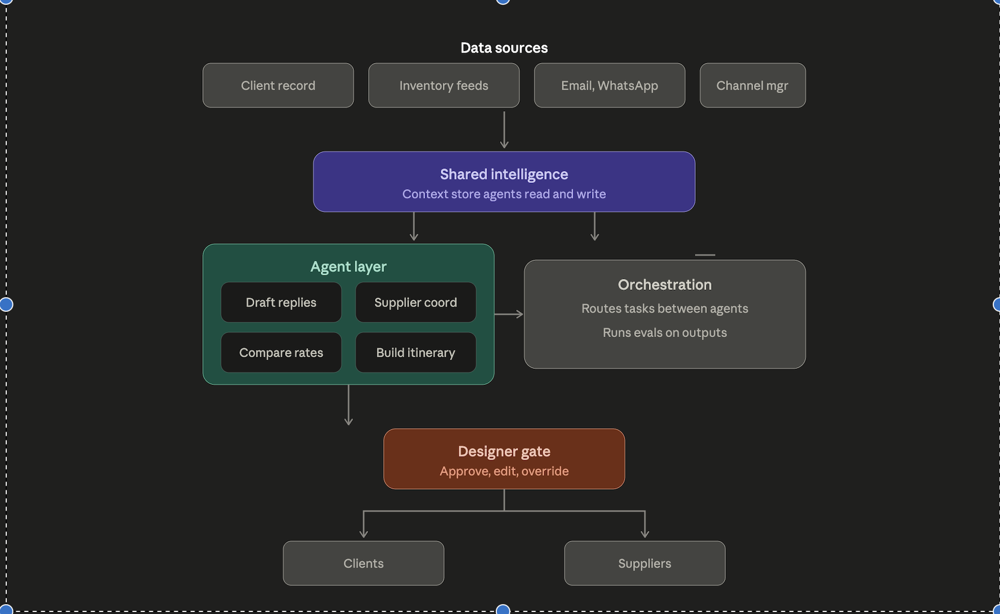

# AI Back Office for Luxury Travel Designers

Luxury travel designers sell judgment and taste — but spend their days on coordination: answering repetitive email, chasing lodges for rates, re-typing quotes into comparisons, and remembering that a client mentioned Patagonia six months ago. This is a working agentic back office that takes the first pass at all of it.

**The core pattern: drafts, not blanks.** Agents do the first pass on everything; the designer keeps the send button.



## What it does

| Surface | The agent's first pass | The designer's decision |
|---|---|---|
| **Today** (`/today`) | Scans the whole book of business and surfaces deadlines, stale threads, and blockers — resolving relative dates like *"can hold till Friday"* against when the email arrived, with every claim citing its source | Done / dismiss (dismissals are remembered across regenerations) |
| **Inbox** (`/inbox`) | Drafts client replies grounded in the full client record — call notes, intake forms, preferences — and self-reports what it couldn't verify into a "needs your judgment" panel | Edit, approve & send, or dismiss |
| **Quotes** (`/trips/[id]/quotes`) | Parses messy supplier emails into a normalized rate comparison — European decimals (`USD 1.890` = $1,890), per-person vs per-room scopes, NET vs gross, buried promos and hold deadlines | Reads a table where every number shows its arithmetic and every assumption is a visible ⚠ warning |
| **Clients** (`/clients/[id]`) | Semantic memory search over everything known about a client — "boats" finds *"Sarah: no boats"* from a call note | Browses preferences labeled confirmed vs inferred, each traceable to its source |
| **Dashboard** (`/dashboard`) | — | Cost/latency/token telemetry per agent, draft acceptance rate and edit distance, latest eval results |

## The trust architecture

This is the part that matters in production:

- **Agents cannot act on the outside world.** The drafting agent can only create `pending` rows; the single send path is a human-triggered action with an atomic claim (a concurrency race here was found by adversarial review and fixed with a regression test — two simultaneous approvals produce exactly one send).
- **The model extracts; the code computes.** Rate totals are deterministic TypeScript that prints its own formula and refuses to guess — party size unknown means a dash and a warning, never a silently wrong number.
- **Everything cites its provenance.** Preferences carry confirmed/inferred labels and source references; every quote row links to the exact email it came from; every draft stores the exact context the model saw (`promptContext`), so a bad draft decomposes into "retrieval missed the fact" vs "the model ignored it."
- **Evals are load-bearing.** A 21-assertion golden suite re-runs extraction on trap emails before any prompt change ships; an LLM-judge grounding eval verifies draft claims against stored context. First judge run scored a good draft 0.50 by over-flagging general knowledge — documented, not hidden: [who evals the eval](docs/senior-reviews.md).

## Numbers (first live runs)

- Golden extraction suite: **21/21** — including the `USD 1.890` European-decimal trap and per-person-scope pricing
- Draft generation: **~$0.025, ~13s** · quote extraction: **~$0.025/email** · Haiku grounding judge: **~$0.003/draft**
- A designer-day at realistic volume (20 drafts + 10 extractions): **well under $1**

## Stack

Next.js 16 (App Router, server actions) · TypeScript · Tailwind v4 · Drizzle ORM · Supabase Postgres (transaction pooler, `prepare: false`) · `claude-opus-4-8` with adaptive thinking + structured outputs (Zod) · Voyage `voyage-4` embeddings with brute-force cosine retrieval (a vector DB at 20 chunks would be résumé-driven engineering) · Vercel

## The engineering story

The interesting artifacts are in `docs/`:

- **[senior-reviews.md](docs/senior-reviews.md)** — every phase's design decisions in defend-this-in-an-interview form: provenance columns, columns-vs-blobs, the check-then-act race, prompt-injection posture ("model warnings are UX, not a security boundary"), the Postgres migration measured against the "cheap to reverse" claim
- **[project-journal.md](docs/project-journal.md)** — the narrative build log
- **[sessions/](docs/sessions/)** — the full, readable transcripts of the AI-orchestrated build: one model planning and reviewing, subagents implementing from self-contained specs, an adversarial cold-context reviewer that found 10 real findings (2 HIGH)

## Running locally

```sh
npm install
# .env.local:
#   ANTHROPIC_API_KEY=...   (agents)
#   VOYAGE_API_KEY=...      (embeddings)
#   DATABASE_URL=...        (Postgres, pooled)
#   DIRECT_URL=...          (Postgres, direct/session — for schema pushes)
npm run db:push && npm run db:seed
npm run index-context        # embed client context
npm run dev                  # → localhost:3000

npm run eval:parse           # golden extraction suite (live API)
npm run eval:grounding       # LLM-judge draft grounding (live API)
```


